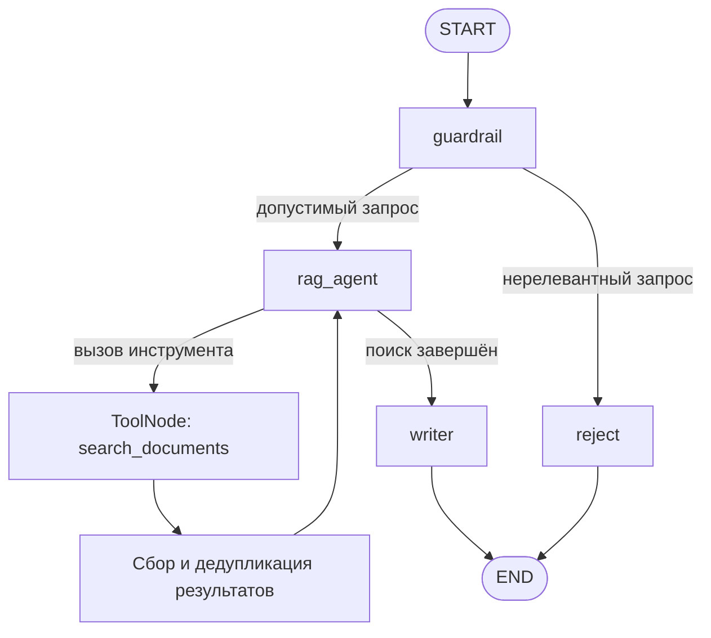

# План проекта: мультиагентный RAG чат-бот на MultiHopRAG

Обновлено: 20 ноября 2026 года.

## Цель проекта и принятые решения

Построить FastAPI-сервис, который отвечает на вопросы по новостному корпусу MultiHopRAG и возвращает ответ вместе с подтверждающими документами. Внутри работает граф LangGraph: guardrail → RAG-агент ↔ ToolNode → writer. Приложение и PostgreSQL запускаются через Docker Compose.

Проект учебный: код пишет автор проекта, помощник объясняет решения, предлагает варианты и проверяет результат согласно `AGENT.local.md`.

Принято:

- Датасет — MultiHopRAG: корпус документов и размеченные вопросы для оценки.
- База данных — PostgreSQL + pgvector, поиск по косинусному расстоянию.
- Обязательные агенты — guardrail, RAG и writer; поиск выполняется отдельным ToolNode.
- Настройки загружаются из `.env` через pydantic-settings, промпты хранятся в `.txt`.
- LLM должна переключаться между поддерживаемыми облачным и локальным провайдерами через конфигурацию.
- Сначала проверяется поиск без агентов, затем оценивается вклад агентного поиска.

Этот план заменяет прежний вариант с arXiv. Загрузка Kaggle-снапшота, поля `arxiv_id` и `abstract`, фильтрация по категориям arXiv и сбор из arXiv API больше не входят в проект.

## Данные и разметка

Описание ниже основано на локальных файлах `data/raw/corpus.json` и `data/raw/MultiHopRAG.json`, проверенных 20 ноября 2026 года. Перед реализацией загрузчика зафиксировать первоисточник, ревизию и условия использования датасета; не переносить сведения о лицензии из прежнего плана.

| Файл | Содержимое | Назначение |
| --- | --- | --- |
| `corpus.json` | 609 новостных статей | Загрузка документов и построение векторного индекса |
| `MultiHopRAG.json` | 2556 размеченных вопросов | Настройка на выделенной части и итоговая оценка |

Поля документа: `title`, `author`, `source`, `published_at`, `category`, `url`, `body`. Поле `author` может быть `null`. Файлы представляют собой JSON-массивы, а не JSON Lines.

Поля вопроса: `query`, `answer`, `question_type`, `evidence_list`. Элемент `evidence_list` содержит метаданные подтверждающей статьи, включая URL, и поле `fact` с подтверждающим фактом.

| Тип вопроса | Количество | Что проверяется |
| --- | --- | --- |
| `inference_query` | 816 | Вывод на основе нескольких источников |
| `comparison_query` | 856 | Сопоставление сведений |
| `temporal_query` | 583 | Временные отношения |
| `null_query` | 301 | Отказ при недостаточности информации |

В текущем корпусе нет повторяющихся URL. Все 6084 ссылки на статьи из разметки найдены в корпусе по URL. Для `null_query` список evidence пуст, эталонный ответ — `Insufficient information.`.

Длина `body` — от 4770 до 71034 символов, в среднем около 10341. Поэтому необходимо обсудить разбиение статей на фрагменты и проверить длину входа токенизатором выбранной embedding-модели. Число символов не равно числу токенов.

### Граница между корпусом и эталонами

- В рабочую БД и векторный индекс загружаются статьи из `corpus.json` и их фрагменты.
- `answer`, `question_type`, `evidence_list` и `fact` доступны только контуру оценки. Агентам при оценке передаётся сам вопрос без этих полей.
- До настройки промптов и параметров выделить воспроизводимые development- и test-части вопросов с сохранением пропорций типов. Размеры и seed согласовать отдельно.
- Проверить повторяющиеся вопросы. Если связанные варианты одного вопроса обнаружены, держать их в одной части.
- Весь корпус документов доступен поиску: разделяются вопросы, а не статьи. Пересечение источников между частями учитывать как ограничение оценки, не обещать проверку переноса на новый корпус.
- Для быстрых проверок использовать небольшую development-выборку. Отложенные вопросы не использовать для подбора параметров.

## Стек

| Слой | Выбор | Назначение |
| --- | --- | --- |
| Оркестрация | LangGraph + LangChain | Состояние, агенты, ToolNode и условные переходы |
| LLM | OpenAI или Ollama; модель обсудить | Tool calling и structured output |
| Эмбеддинги | Sentence Transformers или OpenAI; модель обсудить | Векторы фрагментов и запросов |
| БД | PostgreSQL + pgvector | Документы, фрагменты, метаданные и векторный поиск |
| Доступ к БД | SQLAlchemy + psycopg | Схема, загрузка и запросы |
| Конфигурация | pydantic-settings | `.env` и валидация параметров |
| API | FastAPI + Uvicorn | `/chat`, проверка работоспособности |
| Окружение | uv + `pyproject.toml` + `uv.lock` | Воспроизводимые зависимости |
| Проверки | pytest + Ruff | Поведение компонентов, стиль и форматирование |
| Развёртывание | Docker + Docker Compose | Приложение, БД и отдельная загрузка данных |

ChromaDB не используется в целевой архитектуре. Удаление неиспользуемых зависимостей выполняет автор проекта при подготовке окружения.

## Архитектура



Guardrail проверяет назначение запроса: вопросы по новостным материалам корпуса, включая сравнение и хронологию, допустимы. Он не определяет наличие ответа до поиска и не ограничивает тематику научными статьями или ML/AI. `null_query` не считается автоматически нерелевантным: допустимый вопрос может остаться без ответа после поиска.

RAG-агент сам выбирает вызовы инструмента, при необходимости разбивает вопрос на подзапросы и собирает сведения из нескольких статей. Writer отвечает только по полученным фрагментам, указывает источники или сообщает о недостаточности сведений.

## Предлагаемая структура репозитория

Использовать существующую папку `rag_agent/`; нижеприведённая структура — ориентир, модули создаются по мере реализации.

```text
RAG-agent/
├── rag_agent/
│   ├── __init__.py
│   ├── main.py
│   ├── config.py
│   ├── llm.py
│   ├── schemas.py
│   ├── db/
│   │   ├── models.py
│   │   └── repository.py
│   ├── tools/
│   │   └── vector_search.py
│   ├── agents/
│   │   ├── guardrail.py
│   │   ├── rag.py
│   │   └── writer.py
│   ├── graph/
│   │   ├── state.py
│   │   └── builder.py
│   ├── prompts/
│   │   ├── loader.py
│   │   ├── guardrail.txt
│   │   ├── rag_agent.txt
│   │   └── writer.txt
│   ├── ingestion/
│   │   ├── load_corpus.py
│   │   ├── preprocess.py
│   │   ├── chunking.py
│   │   └── embed_and_store.py
│   └── evaluation/
│       ├── load_questions.py
│       ├── split.py
│       ├── metrics.py
│       └── run.py
├── tests/
├── data/
│   ├── raw/
│   │   ├── corpus.json
│   │   └── MultiHopRAG.json
│   └── evaluation/
├── Plan/
├── Dockerfile
├── docker-compose.yml
├── .env.example
├── pyproject.toml
├── uv.lock
└── README.md
```

## Поэтапный план работ

### Этап 0. Рабочее окружение

- [x] Созданы Git-репозиторий, `pyproject.toml`, `uv.lock`, `.python-version` и `.gitignore`.
- [x] Скачаны оба файла MultiHopRAG в `data/raw/`.
- [ ] Восстановить `.venv`: при проверке она ссылалась на отсутствующий интерпретатор Python 3.11.9.
- [ ] Проверить установку зависимостей из lock-файла и импорт основных библиотек.
- [ ] Добавить Ruff в development-зависимости и согласовать настройки проверки PEP 8 и форматирования.
- [ ] Убрать неиспользуемые зависимости после проверки выбранного стека.
- [ ] Добавить предназначенные для репозитория файлы конфигурации и lock-файл в Git; секреты и данные оставить вне Git.

Результат: воспроизводимое окружение, в котором запускается Python и доступны библиотеки проекта.

### Этап 1. Конфигурация и выбор моделей

- [ ] Обсудить LLM и embedding-модель, язык вопросов первого прототипа и доступные вычислительные ресурсы. Корпус и размеченные вопросы англоязычные; русские запросы требуют отдельной проверки качества.
- [ ] Описать `Settings` в `rag_agent/config.py`.
- [ ] Предусмотреть параметры: `LLM_PROVIDER`, `LLM_MODEL`, `LLM_TEMPERATURE`, ключ и адрес провайдера, `EMBEDDING_PROVIDER`, `EMBEDDING_MODEL`, `EMBEDDING_DIM`, параметры PostgreSQL, пути данных, `TOP_K`, необязательный `SIMILARITY_THRESHOLD`, `MAX_SEARCH_CALLS`, `MAX_CONTEXT_TOKENS` и таймауты.
- [ ] После выбора chunking добавить параметры размера и перекрытия с явно указанной единицей измерения.
- [ ] Создать `.env.example` без секретов; проверять обязательные поля для выбранного провайдера.
- [ ] Реализовать фабрики chat-модели и embeddings. Проверить поддержку tool calling и structured output выбранными моделями.
- [ ] Фиксировать идентификатор и параметры embedding-модели при индексации. Смена embedding-модели требует переиндексации даже при той же размерности; смена только chat-модели — нет.

### Этап 2. Валидация и подготовка данных

- [ ] Описать отдельные схемы документа, вопроса и evidence; допускать отсутствие автора.
- [ ] Написать загрузчик JSON-массива `corpus.json` и отдельный загрузчик вопросов для оценки.
- [ ] Проверить обязательные поля, пустые тексты, уникальность URL, даты и соответствие evidence корпусу. Зафиксировать контрольные суммы входных файлов.
- [ ] Сохранять исходный `body`; нормализовать пробелы и переносы без потери дат, чисел и порядка абзацев.
- [ ] Присвоить стабильный `document_id`, связанный с URL. Для этой версии корпуса URL использовать как уникальный ключ статьи.
- [ ] Обсудить chunking: фиксированные окна токенов проще для baseline; разбиение по абзацам с ограничением длины лучше сохраняет структуру, но сложнее. Размер и overlap выбрать по development-оценке.
- [ ] Каждый фрагмент связать с документом и его позицией; для embeddings рассмотреть текст `title + chunk_text` с учётом лимита модели.
- [ ] Сохранить воспроизводимое разбиение вопросов и небольшую development-выборку для быстрых запусков.

Результат: валидный корпус, фрагменты и независимый набор эталонов для оценки.

### Этап 3. PostgreSQL + pgvector и индексация

- [ ] Поднять сервис БД в Docker Compose уже на этом этапе, включить расширение `vector`.
- [ ] Создать таблицу `documents`: `id`, `url` (unique), `title`, nullable `author`, `source`, `category`, `published_at` с часовым поясом, `body`, `content_hash`.
- [ ] Создать таблицу `chunks`: `id`, `document_id` (foreign key), `chunk_index`, `text`, `embedding vector(EMBEDDING_DIM)`; уникальность пары `(document_id, chunk_index)`.
- [ ] Сохранить метаданные индексации: embedding-модель, размерность и параметры chunking; определить способ инициализации и обновления схемы.
- [ ] Посчитать embeddings батчами и записать в БД; размер батча подобрать под ресурсы и лимиты провайдера.
- [ ] Обеспечить повторяемую загрузку без дублей. При изменении статьи или chunking удалять устаревшие фрагменты в рамках согласованного обновления.
- [ ] Реализовать точный поиск по `<=>` как проверяемый baseline: `similarity = 1 - cosine_distance`, меньшее расстояние означает более близкий результат.
- [ ] Рассматривать HNSW с `vector_cosine_ops` после измерения задержки и качества относительно точного поиска; для небольшого корпуса индекс не является обязательным первым шагом.

Результат: сохранённые статьи и фрагменты с заранее посчитанными embeddings, работающий запрос поиска.

### Этап 4. Поиск без агентов и инструмент

- [ ] Проверить цепочку «вопрос → embedding → PostgreSQL → фрагменты и документы» на development-вопросах.
- [ ] Для document-level оценки объединять результаты фрагментов по `document_id`/URL; явно определить ранжирование документов, например максимум similarity среди найденных фрагментов.
- [ ] Различать число возвращаемых фрагментов и число уникальных документов. Для метрики document Recall@k использовать первые k уникальных документов.
- [ ] Получить исходные метрики до переформулирования запросов и агентного цикла.
- [ ] Написать `search_documents(query, top_k)` с понятным описанием инструмента и ограничением входных параметров.
- [ ] Возвращать `chunk_id`, `document_id`, URL, заголовок, текст фрагмента, метаданные и similarity. Сохранять достаточный текст для writer, а не только короткий snippet для интерфейса.
- [ ] Начать без жёсткого similarity-порога; если он понадобится, подобрать на development-части. Similarity не является вероятностью правильного ответа.

### Этап 5. Промпты

- [ ] Создать `guardrail.txt`, `rag_agent.txt`, `writer.txt` и загрузчик с кэшированием.
- [ ] Описать назначение сервиса по новостному корпусу, сравнение источников и работу с датами.
- [ ] В RAG-промпте объяснить поиск по подзапросам, накопление evidence и условия завершения.
- [ ] В writer-промпте потребовать опору на полученные фрагменты, проверяемые ссылки и отказ при недостаточности данных.
- [ ] Рассматривать текст документов как данные, а не инструкции для изменения поведения агента.

### Этап 6. Состояние графа

- [ ] Создать отдельный `AgentState(TypedDict)`.
- [ ] Поля: `messages` с reducer `add_messages`, `question`, `is_relevant`, `guardrail_reason`, `retrieved_chunks`, `retrieved_docs`, `search_calls`, `final_answer`, `used_doc_ids`, `answer_status`.
- [ ] Использовать типизированные структуры результатов вместо произвольных словарей там, где схема уже известна.
- [ ] Определить правила накопления и дедупликации результатов нескольких поисков и ограничение контекста writer.
- [ ] Различать статусы `answered`, `insufficient_information`, `rejected`; технические ошибки обрабатывать отдельно, не считать отсутствием ответа в корпусе.

### Этап 7. Агенты

- [ ] Guardrail: structured output с допустимостью запроса и причиной. Не отклонять вопрос только потому, что ответ предположительно отсутствует.
- [ ] RAG: `bind_tools([search_documents])`, самостоятельный выбор поиска, при необходимости несколько подзапросов и объединение источников.
- [ ] Writer: structured output с `answer`, `used_doc_ids`, `answer_status`. Проверять, что указанные ID действительно были найдены; формировать URL и метаданные из БД.
- [ ] Для недостаточности данных возвращать явный статус; в англоязычной оценке использовать согласованный ответ `Insufficient information.`.
- [ ] Реализовать сбор результатов ToolNode в состояние и передачу нужных фрагментов writer.
- [ ] Обрабатывать пустые результаты, противоречия и неполное покрытие составного вопроса. Дату публикации не приравнивать к дате события.

### Этап 8. Сборка LangGraph

- [ ] Реализовать узлы и переходы из схемы архитектуры, включая сбор результатов после ToolNode.
- [ ] Самостоятельное решение RAG-агента о вызове tool сохранить; лимит числа поисков и общий лимит шагов задавать отдельно.
- [ ] При исчерпании бюджета завершать обработку согласованным путём, соблюдая протокол парных tool calls и ToolMessage; writer получает найденные данные и информацию о неполноте поиска.
- [ ] Проверить пути: отказ guardrail, успешный поиск, повторный поиск, пустой результат и исчерпание бюджета.
- [ ] Сохранить диаграмму графа для README.
- [ ] Историю нескольких пользовательских ходов и checkpointer добавлять отдельным расширением; для baseline выполнять каждый benchmark-вопрос с чистым состоянием.

### Этап 9. FastAPI

- [ ] `POST /chat`: вход `{question}`, выход `{answer, answer_status, is_relevant, reason?, documents}`.
- [ ] В `documents` возвращать найденные подтверждающие статьи: `document_id`, `title`, `author`, `source`, `category`, `published_at`, `url`, similarity и использованные текстовые фрагменты с `chunk_id`. Эталонные evidence в ответ не подмешивать.
- [ ] Создавать граф и клиенты один раз при старте через `lifespan`, закрывать ресурсы при остановке.
- [ ] Разделить проверку работы процесса и готовности зависимостей; healthcheck не должен требовать платной генерации на каждый вызов.
- [ ] Добавить таймауты, обработку недоступности БД/LLM и логирование задержки, вызовов tools и ошибок.

### Этап 10. Развёртывание

- [ ] Создать Dockerfile с запуском `uvicorn rag_agent.main:app` и воспроизводимой установкой зависимостей.
- [ ] Дополнить Compose сервисом приложения и отдельным ingestion-сервисом/профилем; у БД — volume и healthcheck. Ollama добавлять, если выбран локальный провайдер.
- [ ] Документировать первичную загрузку: файлы корпуса → инициализация схемы → ingestion → готовность сервиса к поиску.
- [ ] Не запускать пересчёт embeddings при каждом старте приложения. Пустую или несовместимую коллекцию выявлять явно.
- [ ] Проверить запуск с чистым volume и повторный запуск с сохранёнными данными.
- [ ] Описать необходимые внешние условия: подготовленные данные, доступ к embedding-модели и выбранной LLM; один запуск Compose сам по себе их не заменяет.

### Этап 11. Проверки и оценка качества

Проверки добавляются вместе с соответствующими компонентами; этот этап собирает итоговую оценку.

- [ ] Проверить валидацию данных, стабильность ID, chunking, соответствие evidence документам и отсутствие дублей при повторной загрузке.
- [ ] Проверить поиск и порядок similarity на небольшой контролируемой фикстуре PostgreSQL.
- [ ] Проверить граф с подменённой chat-моделью, поддерживающей необходимые тестовые tool calls, и API через TestClient.
- [ ] Отдельно оценить исходный поиск по вопросу и итоговый агентный поиск при заданном бюджете вызовов. Для агента учитывать объединённый набор результатов и стоимость нескольких поисков.
- [ ] Для вопросов с evidence считать document Recall@k: доля эталонных URL среди первых k уникальных найденных документов.
- [ ] Считать полное покрытие evidence: доля вопросов, для которых найдены все эталонные документы. Hit@k использовать только как дополнительную метрику — один найденный источник не гарантирует ответ на multi-hop вопрос.
- [ ] Для ответов считать нормализованный Exact Match и token F1, фиксируя правила нормализации и отдельно разбирая эквивалентные формулировки. Вручную проверять обоснованность по источникам и ссылки.
- [ ] Для `null_query` отдельно считать долю корректных отказов, а для ответимых вопросов — долю ошибочных отказов. Retrieval recall для пустого evidence не определять и не смешивать с остальными вопросами.
- [ ] Выводить результаты по типам вопросов, задержку и число поисков; сохранять настройки моделей, chunking, top_k, seed, версии данных и промптов.
- [ ] После настройки на development выполнить оценку на отложенной части. Проверяемые на разметке критерии успеха согласовать после baseline, не назначать произвольные целевые числа заранее.

### Этап 12. Документация

- [ ] README: цель, происхождение и условия использования MultiHopRAG, схема БД и графа, подготовка данных и запуск.
- [ ] Описать конфигурацию, смену LLM и отдельные правила переиндексации при смене embeddings/chunking.
- [ ] Добавить примеры ответа с несколькими источниками, недостаточности данных и отклонения нерелевантного запроса.
- [ ] Привести воспроизводимую команду оценки и таблицу результатов baseline/агентного поиска.
- [ ] Указать ограничения: фиксированный новостной корпус, язык, ограничения разметки и выбранного разбиения вопросов.

## Опциональные расширения

- Дополнительный SQL-tool `document_stats` для статистик по `source`, `category`, периоду публикации; считать статьи, а не число их фрагментов. Оценивать его отдельно от benchmark, если соответствующих вопросов нет в разметке.
- Получение дополнительных фрагментов или полной статьи по `document_id` при нехватке контекста.
- Reranker, гибридный поиск и улучшенное разбиение вопроса — после фиксации исходного baseline и оценки каждого изменения.
- Воспроизводимая загрузка датасета из подтверждённого первоисточника с закреплённой ревизией. Это отдельная задача от обязательного импорта уже скачанного корпуса.
- Диалоговая история, потоковая выдача и интерфейс — после проверки основного сценария.

## Решения для обсуждения перед реализацией

| Решение | Варианты и компромиссы |
| --- | --- |
| LLM | Облачная — меньше локальной настройки, но внешние вызовы и расходы; локальная — контроль запуска, но требования к ресурсам и отдельная проверка tool calling |
| Embeddings | Локальные — вычисления на своей машине; API — внешние лимиты и стоимость. Качество сравнивать на development-вопросах |
| Chunking | Окна токенов — простой baseline; абзацы с лимитом — сохранение структуры ценой более сложной логики |
| Индекс | Точный поиск — эталон качества; HNSW — возможное ускорение с приближённым поиском, полезность проверить измерениями |
| Язык первого прототипа | Английский соответствует разметке; русский требует отдельного решения для поиска и оценки |
| Разбиение вопросов | Согласовать размеры development/test и seed до подбора параметров |

## Соответствие обязательным требованиям

| Требование | Реализация |
| --- | --- |
| Векторная БД с заранее посчитанными embeddings | PostgreSQL + pgvector, таблицы documents/chunks и ingestion |
| Мультиагентная система на LangGraph | Guardrail, RAG, writer и общий граф |
| Самостоятельный вызов tools RAG-агентом | Tool calling и цикл с ToolNode |
| Поиск по косинусному расстоянию отдельным ToolNode | search_documents и оператор `<=>` |
| Structured output по возможности | Guardrail и writer |
| Отдельный TypedDict состояния | AgentState |
| Промпты в txt | rag_agent/prompts/ |
| Конфигурация через .env и pydantic-settings | Settings и фабрики моделей |
| Ответ и релевантные документы | Контракт POST /chat со ссылками и текстовыми фрагментами |
| FastAPI и Docker Compose | Приложение, БД и документированная первичная загрузка |

## Ближайший практический результат

Сначала восстановить окружение, согласовать модели и chunking, затем реализовать конфигурацию и загрузчик корпуса. Первая проверяемая версия должна сохранять статьи и embeddings фрагментов в PostgreSQL, находить источники по development-вопросам и считать document Recall@k без участия агентов. На этой основе строятся ToolNode, агенты, граф и API.
